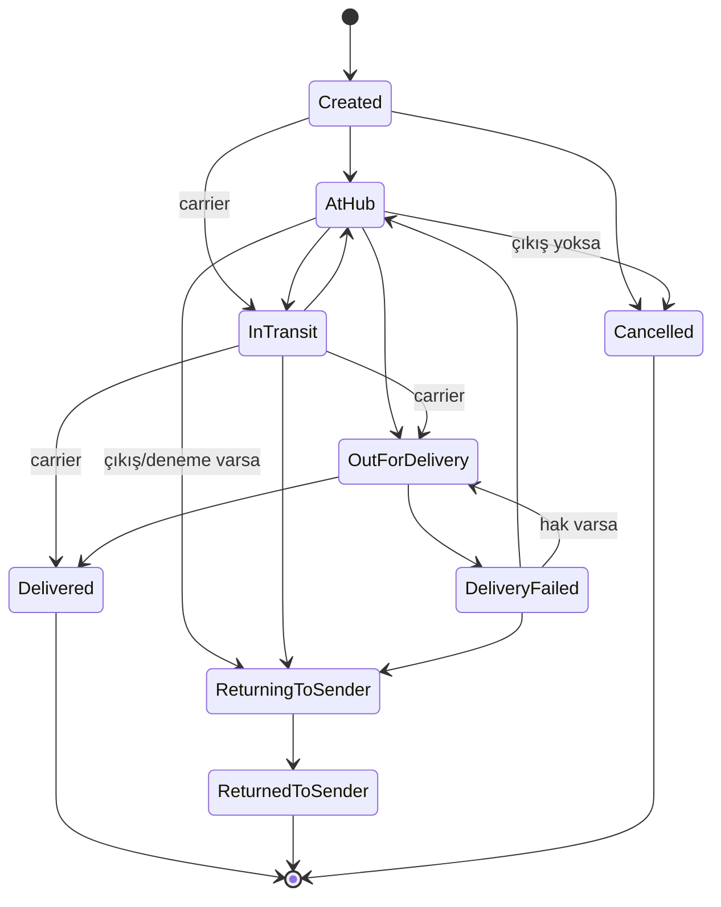

# 02 — Domain Modeli ve Durum Makineleri

> İlgili: [01 Gereksinimler](01-product-requirements.md) · [04 Veritabanı](04-database-design.md) · [05 API](05-api-and-event-contracts.md)

Bu belgedeki isimler (entity, enum, durum, olay, sonuç) bütün belgelerde ve kodda aynen kullanılır.

## 1. Sözlük

| Terim | Kod adı | Tanım |
|---|---|---|
| Gönderi | `Shipment` | Durum makinesine sahip ticari/operasyonel birim (aggregate root). |
| Paket | `Package` | Gönderiye ait fiziksel koli; kendi etiketi ve son konumu var, durum makinesi yok. |
| Taraf snapshot'ı | `ShipmentParty` | Gönderen (`Sender`) veya alıcı (`Recipient`) adres/iletişim bilgisinin oluşturma anındaki kopyası. |
| Hub | `Hub` | Depo/aktarma merkezi. Kod ör. `IST-01`. |
| Taşıyıcı | `Carrier` | Simüle dış taşıyıcı. Kod ör. `SIMEX`. |
| Takip olayı | `TrackingEvent` | Zaman çizelgesindeki bir olay; güncel durumu değiştirmiş veya değiştirmemiş olabilir. |
| Teslimat denemesi | `DeliveryAttempt` | Numaralı teslim girişimi ve sonucu. |
| İstisna | `ShipmentException` | İnsan müdahalesi gerektiren durum; sahibi ve çözüm kaydı vardır. (.NET `Exception` ile karışmaması için kodda daima `ShipmentException`.) |
| Carrier inbox kaydı | `CarrierEventReceipt` | Webhook ile alınan her olayın kalıcı makbuzu ve işlenme sonucu. |
| Olay sonucu | `EventOutcome` | `Applied`, `Duplicate`, `Stale`, `Rejected`, `PendingReview`, `Conflict`. |

## 2. Aggregate sınırları

```
Shipment (aggregate root, optimistic concurrency token)
 ├── ShipmentParty x2 (Sender, Recipient)   — owned, oluşturmadan sonra değişmez (v1)
 ├── Package 1..20                           — konum bilgisi gönderi transaction'ında güncellenir
 ├── TrackingEvent 0..n                      — append-only; status değişimiyle aynı transaction
 └── DeliveryAttempt 0..n                    — append-only

ShipmentException (ayrı aggregate, kendi concurrency token'ı)  → ShipmentId ile referans
CarrierEventReceipt (ayrı aggregate, lease alanları)          → ShipmentId (çözülürse) ile referans
Hub, Carrier (referans verisi)
```

**Neden `ShipmentException` ayrı aggregate?** İstisnanın atanması/çözümü gönderi durumunu değiştirmez; aynı satırı kilitlemek gereksiz concurrency çakışması üretir. İstisna açılışı ise gönderi değişikliğiyle aynı transaction'da yapılır (bkz. §7).

**Neden `TrackingEvent` gönderi aggregate'i içinde?** Durum geçişinin kanıtıdır; durum değişirken kaydı yazılmazsa geçmiş ile güncel durum ayrışır. Aggregate yüklenirken tüm olaylar yüklenmez; kurallar için gereken özet alanlar (`StatusOccurredAt`, `LastCarrierSequence`, `DeliveryAttemptCount`, `HasDeparted`) gönderi satırında tutulur.

## 3. Gönderi durum makinesi

### 3.1 Durumlar

| Durum | Anlam | Terminal |
|---|---|---|
| `Created` | Kayıt açıldı, fiziksel kabul henüz yok | Hayır |
| `AtHub` | Gönderi bir hub'da (`CurrentHubId`) | Hayır |
| `InTransit` | Hub'dan çıktı / taşıyıcıda yolda | Hayır |
| `OutForDelivery` | Varış hub'ından dağıtıma çıktı | Hayır |
| `DeliveryFailed` | Son deneme başarısız; yeni deneme veya iade bekleniyor | Hayır |
| `Delivered` | Tüm paketler alıcıya teslim edildi | **Evet** |
| `ReturningToSender` | Göndericiye iade yolunda | Hayır |
| `ReturnedToSender` | Göndericiye teslim edildi | **Evet** |
| `Cancelled` | Fiziksel hareket başlamadan iptal edildi | **Evet** |

"Gecikmiş" (`IsDelayed`) bir durum değil, türetilmiş bayraktır: terminal olmayan, `ReturningToSender` olmayan ve `PromisedDeliveryDate` < bugün (Europe/Istanbul) olan gönderi. İadedeki gönderi alıcıya verilen söz kapsamından çıktığı için gecikme sayılmaz; iade süresi v2'de ayrı ölçülür.

### 3.2 Geçiş tablosu

Kaynak (`EventSource`): `HubScan`, `Operator`, `Carrier`, `System`.

| # | Kimden | Kime | Tetikleyici | İzinli kaynak | Ön koşul |
|---|---|---|---|---|---|
| T1 | `Created` | `AtHub` | Varış taraması / `ArrivedAtFacility` | HubScan, Carrier | — |
| T2 | `Created` | `InTransit` | `PickedUp` / `InTransit` | Carrier | Gönderi bu carrier'a atanmış |
| T3 | `Created` | `Cancelled` | İptal | Operator | Carrier'a devredilmemiş |
| T4 | `AtHub` | `InTransit` | Çıkış taraması / `Departed` | HubScan, Carrier | Tüm paketler `CurrentHubId`'de (HubScan için) |
| T5 | `AtHub` | `OutForDelivery` | Dağıtıma çıkış | HubScan, Carrier | Hub = varış hub'ı; tüm paketler hub'da; `DeliveryAttemptCount < MaxAttempts` |
| T6 | `AtHub` | `Cancelled` | İptal | Operator | `HasDeparted = false`, carrier'a devredilmemiş |
| T7 | `AtHub` | `ReturningToSender` | İade başlat | Operator | `HasDeparted = true` veya `DeliveryAttemptCount > 0` |
| T8 | `AtHub` | `AtHub` (başka hub) | Farklı hub'da varış taraması | HubScan, Carrier | Çıkış taraması atlanmış; timeline'a `MissingDepartureScan` notu |
| T9 | `InTransit` | `AtHub` | Varış taraması / `ArrivedAtFacility` | HubScan, Carrier | — |
| T10 | `InTransit` | `OutForDelivery` | `OutForDelivery` | Carrier | — |
| T11 | `InTransit` | `Delivered` | `Delivered` | Carrier | Atlamalı ileri geçiş; tüm paketler teslim |
| T12 | `InTransit` | `ReturningToSender` | İade başlat / `ReturnInitiated` | Operator, Carrier | — |
| T13 | `OutForDelivery` | `Delivered` | Başarılı deneme / `Delivered` | HubScan¹, Operator, Carrier | Hep-ya-hiç teslim |
| T14 | `OutForDelivery` | `DeliveryFailed` | Başarısız deneme / `DeliveryFailed` | HubScan¹, Operator, Carrier | Neden kodu zorunlu |
| T15 | `DeliveryFailed` | `AtHub` | Varış taraması | HubScan, Carrier | — |
| T16 | `DeliveryFailed` | `OutForDelivery` | Yeni dağıtıma çıkış | HubScan, Carrier | `DeliveryAttemptCount < MaxAttempts` (+ onaylı ek hak) |
| T17 | `DeliveryFailed` | `ReturningToSender` | İade başlat / `ReturnInitiated` | Operator, Carrier | — |
| T18 | `ReturningToSender` | `ReturningToSender` | Hub taramaları | HubScan, Carrier | Durum aynı, `CurrentHubId` güncellenir |
| T19 | `ReturningToSender` | `ReturnedToSender` | Göndericiye teslim / `ReturnedToSender` | Operator, Carrier | — |

¹ Teslimat denemesi, hub görevlisi tarafından el terminalinden de girilebilir; kaynak yine `HubScan` olarak işaretlenir.

**Tabloda olmayan her geçiş reddedilir.** Terminal durumlardan (`Delivered`, `ReturnedToSender`, `Cancelled`) hiçbir çıkış yoktur.



### 3.3 Kararların gerekçeleri

**İptal sınırı.** İptal yalnız fiziksel hareket başlamadan (ilk çıkış taraması veya carrier'a devirden önce) mümkündür. Çıkıştan sonra koli fiziksel olarak ağdadır; "iptal" demek kolinin sahipsiz kalması anlamına gelir. Bu nedenle çıkış sonrası durdurma talebi `ReturningToSender` ile modellenir. API'de iptal ve iade ayrı komutlardır; iptal komutu çıkış yapmış gönderide `409 shipment-not-cancellable` döner ve yanıt `returnToSenderAllowed: true` ipucunu içerir.

**Delivered terminaldir; teslim sonrası iade ayrı lifecycle'dır.** Teslim edilmiş gönderi yeniden açılmaz. Teslim sonrası müşteri iadesi, `Kind = Return` ve `RelatedShipmentId` ile **yeni bir gönderi** olarak açılır (v2). Böylece teslim kanıtı, SLA ölçümü ve zaman çizelgesi bozulmaz. `ReturningToSender` / `ReturnedToSender` ise teslim **edilemeyen** gönderinin aynı gönderi üzerinde geri dönüşüdür; iki kavram karıştırılmaz.

**Hub taraması katı, carrier atlamalı.** Kendi hub'larımızdaki taramayı biz kontrol ettiğimiz için ara adım atlanamaz (T8 hariç, bilgi notuyla). Carrier'lar ara olayları her zaman göndermez; bu yüzden carrier için ileri atlama (T2, T10, T11) izinlidir. `Created → Delivered` gibi bütün ağı atlayan carrier olayı `PendingReview` olur.

### 3.4 Paket bazlı tarama ve gönderi geçişi

Hub taramaları paket etiketiyle yapılır; durum makinesi gönderi düzeyindedir. Bağlantı kuralı:

1. Her tarama önce paketin konumunu günceller (`Package.CurrentHubId`, `LastScanType`, `LastScannedAt`). `Departure` ve `OutForDelivery` taramasında paketin `CurrentHubId`'si NULL olur.
2. Gönderi geçişi, o tipteki **ilk uygun paket taramasında** olur (ör. ilk koli varış taraması T1/T9; ilk koli çıkış taraması T4 — konsolidasyon koşuluyla).
3. Aynı gönderinin diğer paketlerinin aynı hub'daki aynı tip taramaları yalnız paket konumunu günceller: sonuç `Applied`, `reasonCode = PackageLocationOnly`, `status_after = NULL`.
4. Paket düzeyinde stale kontrolü: `evt.OccurredAt < Package.LastScannedAt` ise tarama `Stale` olur (gönderi durumuna da paket konumuna da dokunmaz). Gönderi düzeyinde §5.3 kural 7 ayrıca uygulanır.
5. Konsolidasyon koşulu (T4, T5): çıkış/dağıtım taramasının yapıldığı anda gönderinin **tüm** paketlerinin `CurrentHubId`'si tarama hub'ı olmalıdır (ilk koli taramasından önce). Sonraki koliler zaten bu kontrolü geçmiş bir gönderiye aittir.

### 3.5 Teslimat denemesi kuralları

- `AttemptNumber` gönderi içinde 1'den başlar ve artar; `(ShipmentId, AttemptNumber)` benzersizdir.
- `MaxAttempts = 3` (konfigürasyon). 3. başarısızlıkta `MaxAttemptsReached` istisnası açılır; T5/T16 reddedilir (`max-attempts-reached`). İstisna `ReattemptApproved` ile çözülürse `ExtraAttemptsGranted` +1 olur.
- `FailureReason`: `RecipientAbsent`, `AddressNotFound`, `RecipientRefused`, `AccessRestricted`, `PackageMissing`, `PackageDamaged`, `Other` (`Other` için not zorunlu).
- Başarılı deneme `DeliveredAt` alanını doldurur (KPI'lar buna dayanır).

## 4. Diğer durum makineleri

### 4.1 İstisna (`ShipmentException`)

| Durum | Anlam |
|---|---|
| `Open` | Açıldı, sahibi yok |
| `Assigned` | Bir kullanıcıya atandı |
| `Resolved` | Çözüm kodu ve notla kapandı (terminal) |

Geçişler: `Open → Assigned` (üzerine al / ata), `Assigned → Assigned` (yeniden ata, yalnız OpsManager veya mevcut sahibi), `Open|Assigned → Resolved`.
Otomatik çözüm: gönderi terminale ulaştığında `DeliveryOverdue` ve `NoMovement` istisnaları `AutoResolved` koduyla kapanır.

**Tipler (`ExceptionType`)**

| Tip | Açan | Varsayılan önem | Not |
|---|---|---|---|
| `DeliveryFailed` | Başarısız deneme | Medium | Açık kayıt varsa yeni kayıt açılmaz; `OccurrenceCount` artar |
| `MaxAttemptsReached` | 3. başarısız deneme | High | Çözüm: `ReattemptApproved` veya `ReturnToSenderInitiated` |
| `DeliveryOverdue` | SLA worker | Medium → gün geçtikçe High | |
| `NoMovement` | SLA worker | Medium | Terminal olmayan gönderide 48 saat olay yok |
| `PackageSplit` | Konsolidasyon reddi | High | Paketler farklı hub'larda |
| `CarrierEventPendingReview` | Ingestion | Medium | Çelişkili ama imzalı carrier olayı |
| `CarrierEventConflict` | Ingestion | High | Aynı event ID, farklı payload |

**Benzersizlik:** `(ShipmentId, Type)` için en fazla bir açık (`Open`/`Assigned`) kayıt.

**Çözüm kodları (`ResolutionCode`)**: `ReattemptApproved`, `ReturnToSenderInitiated`, `CarrierConfirmed`, `EventAppliedManually`, `EventDiscarded`, `PackagesConsolidated`, `NoActionNeeded`, `AutoResolved`. Gönderi işlemi tetikleyen kodlar (`ReturnToSenderInitiated`, `EventAppliedManually`) ilgili gönderi komutunu aynı transaction'da çalıştırır; komut reddedilirse çözüm de commit edilmez.

### 4.2 Carrier inbox işleme (`CarrierEventReceipt.ProcessingStatus`)

`Received → Processing (lease) → Processed` · `Processing → Received` (geçici hata, backoff ile) · `Processing → DeadLettered` (5 deneme sonrası). `Outcome` yalnız `Processed` iken doludur.

## 5. Olay alımı ve sıralama kuralları

Bu bölüm hub taraması, operatör komutu ve carrier olayının **tek bir karar fonksiyonundan** geçtiğini tanımlar:

```
Decide(ShipmentState state, IncomingEvent evt, Policy policy) -> Decision
```

Saf (pure) fonksiyondur; DB veya saat erişimi yoktur (`now` parametre olarak verilir). Unit testlerin ana hedefi budur.

### 5.1 Zaman alanları

| Alan | Kaynak | Kullanım |
|---|---|---|
| `OccurredAt` | Olayı üreten taraf (el terminali, carrier) | Fiziksel sıra, timeline sıralaması, stale kararı |
| `OccurredAtOffsetMinutes` | Gelen ISO-8601 değerinin ofseti | Orijinal yerel saati göstermek için |
| `ReceivedAt` | Sunucu saati, inbox/komut alındığında | Gecikme ölçümü, denetim |
| `ProcessedAt` | Sunucu saati, karar verildiğinde | Worker gecikme metriği |
| `StatusOccurredAt` (Shipment) | Güncel durumu belirleyen olayın `OccurredAt`'i | Stale karşılaştırması |
| `StatusChangedAt` (Shipment) | Güncel durumun sunucuda yazıldığı an | Değişiklik akışı, UI "son güncelleme" |

Saat sapması kuralı: `OccurredAt > ReceivedAt + 15 dk` → `Rejected (future-timestamp)`. `OccurredAt < ReceivedAt − 7 gün` → `PendingReview (too-old)` (hiçbir zaman otomatik uygulanmaz).

### 5.2 Sonuçlar

| Sonuç | Anlam | Timeline'a yazılır mı? | Durum değişir mi? |
|---|---|---|---|
| `Applied` | Kurallara uydu ve uygulandı | Evet | Evet (T8/T18'de yalnız konum) |
| `Duplicate` | Aynı olay zaten kayıtlı (teknik veya iş tekrarı) | Hayır (orijinale bağlanır) | Hayır |
| `Stale` | Geçerli ama güncel durumdan eski; geçmişte yeri var | Evet, `IsLate = true` işaretli | Hayır |
| `Rejected` | Geçersiz (bilinmeyen gönderi, yetkisiz carrier/hub, izinsiz geçiş, gelecek zaman) | Hayır | Hayır |
| `PendingReview` | İmzalı/yetkili ama mevcut durumla çelişen ve daha yeni olay | Evet, `Outcome = PendingReview` | Hayır; istisna açılır |
| `Conflict` | Aynı carrier event ID farklı payload ile geldi | Hayır | Hayır; istisna + audit |

`Rejected` sonuçlar inbox kaydında (carrier) veya API yanıtı + audit kaydında (kullanıcı komutu) saklanır; yani kaybolmaz ama zaman çizelgesini kirletmez.

### 5.3 Karar sırası

Kurallar aşağıdaki **sırayla** değerlendirilir; ilk eşleşen sonucu belirler.

1. **Kimlik/yetki:** Gönderi bulunamadı → `Rejected (unknown-shipment)`. Carrier olayı, gönderi o carrier'a atanmamışsa → `Rejected (carrier-not-assigned)`. Hub taraması, kullanıcı o hub'a atanmamışsa → komut düzeyinde `403`.
2. **Saat sapması:** §5.1.
3. **Teknik tekrar:** Aynı `(CarrierId, ExternalEventId)` → inbox katmanında `Duplicate` veya `Conflict` (bkz. §5.4). Hub taraması için aynı `(HubId, ClientScanId)` → `Duplicate`.
4. **İş tekrarı:** §5.5 → `Duplicate`.
5. **Carrier sequence:** Olayda `Sequence` varsa ve `Sequence <= Shipment.LastCarrierSequence` (aynı carrier) → `Stale`.
6. **Terminal koruma:** Gönderi terminal ise: olay `StatusOccurredAt`'ten eskiyse → `Stale`; daha yeni ve farklı durum iddia ediyorsa → `PendingReview (contradicts-terminal)`; aynı terminal durumu iddia ediyorsa → `Duplicate`.
7. **Zaman sırası:** `evt.OccurredAt < Shipment.StatusOccurredAt` → `Stale` (geçmişe yazılır, durum korunur).
8. **Geçiş tablosu:** Geçiş izinli ve ön koşullar sağlanıyorsa → `Applied`. Ön koşul sağlanmıyorsa (ör. konsolidasyon, max deneme): kullanıcı komutunda `Rejected` + neden kodu; carrier olayında `PendingReview`. Geçiş tabloda yoksa: kullanıcı komutunda `Rejected (transition-not-allowed)`; carrier olayında `PendingReview`.

Olaylar **körlemesine timestamp'e göre sıralanıp yeniden oynatılmaz.** Zaman yalnız kural 7'de kullanılır; kural 5 ve 6 kaynak güveni ve terminal korumayı önce uygular.

### 5.4 Aynı event ID, farklı payload (`Conflict`)

- Inbox benzersiz anahtarı `(CarrierId, ExternalEventId)`.
- Yeni gelen payload'ın kanonik SHA-256 hash'i mevcut kayıtla aynıysa → `Duplicate`, `200`.
- Farklıysa → ilk kayıt **değişmez**; yeni payload `carrier_event_conflicts` tablosuna (hash + 30 gün ham payload) yazılır, audit kaydı (`CarrierEventConflictDetected`) ve `CarrierEventConflict` istisnası açılır (gönderi çözülebiliyorsa). Carrier'a `409 carrier-event-id-conflict` döner. Otomatik olarak hiçbir payload "kazanmaz"; insan karar verir.

### 5.5 İş tekrarı (farklı event ID, aynı iş olayı)

İki olay aşağıdakilerin **hepsi** sağlanıyorsa aynı iş olayıdır:

- aynı gönderi ve aynı kaynak (aynı carrier ya da aynı hub),
- aynı normalize olay tipi (`TrackingEventType`),
- aynı konum kodu (hub kodu / carrier facility kodu; ikisi de boşsa eşit sayılır),
- teslimat denemesi olaylarında aynı `AttemptNumber`,
- `|OccurredAt₁ − OccurredAt₂| ≤ 120 sn` (konfigürasyon: `BusinessDedupWindow`).

Carrier `Sequence` gönderiyorsa `(CarrierId, ShipmentId, Sequence)` eşitliği tek başına yeterlidir.
Uygulama: `TrackingEvent.BusinessKey = {source}:{sourceId}:{eventType}:{locationCode}:{attempt}` alanı indekslenir; aday kayıtlar `BusinessKey` + zaman penceresiyle sorgulanır. Pencere tabanlı olduğu için unique constraint yerine transaction içinde gönderi satırı kilitliyken kontrol edilir (§6).

### 5.6 Örnek: teslimattan sonra eski `InTransit` gelmesi

1. 09:10 `OutForDelivery` (Applied), 11:42 `Delivered` (Applied) → `Status = Delivered`, `StatusOccurredAt = 11:42`.
2. 12:05'te carrier'dan `OccurredAt = 08:30` olan `InTransit` gelir.
3. Kural 6: gönderi terminal, olay 11:42'den eski → `Stale`.
4. Timeline'da 08:30 konumunda "Geç alındı (12:05)" etiketiyle görünür; durum `Delivered` kalır.
5. Aynı olay `OccurredAt = 13:00` ile gelseydi → `PendingReview (contradicts-terminal)` + `CarrierEventPendingReview` istisnası.

## 6. Eşzamanlılık kararları

**Mekanizma:** `shipments` satırında PostgreSQL `xmin` sistem kolonu EF Core concurrency token olarak kullanılır. Her durum değiştiren komut: gönderiyi oku → `Decide` → değişiklikleri yaz → `UPDATE ... WHERE id = @id AND xmin = @version`. Etkilenen satır 0 ise `DbUpdateConcurrencyException`.

| Senaryo | Karar |
|---|---|
| İki hub aynı anda farklı tarama gönderir | İlk commit eden kazanır. İkinci komut **otomatik yeniden değerlendirilir** (en fazla 3 deneme, 20–200 ms jitter): yeni durumu okur, `Decide`'ı tekrar çalıştırır. Sonuç `Applied`, `Stale` veya `Rejected` olabilir. Tarama fiziksel bir olgu olduğu için istemciden versiyon istenmez. |
| Operatör komutu ile webhook işlenmesi çakışır | Webhook worker yeniden değerlendirir (yukarıdaki gibi). Operatör komutları (`cancel`, `return-to-sender`, istisna çözümü) **`If-Match` ETag zorunlu**: kullanıcı ekranda gördüğü duruma göre karar verdiği için çakışmada `412 precondition-failed` + güncel durum döner, kullanıcı yeniden bakar. |
| Aynı gönderiye iki carrier olayı aynı anda | Worker gönderi başına seri işlemez; optimistic retry yeterli. Yeniden denemeler tükenirse inbox kaydı `Received`'e döner ve backoff ile tekrar işlenir; kayıp yok. |
| İş tekrarı kontrolü yarışı | **Karar değişikliği (Dilim 1):** `xmin` yalnız gönderi satırı güncellendiğinde değişir; paket-yalnız, `Stale` veya yalnız olay ekleyen işlemlerde değişmez. Bu yüzden "olay INSERT + mevcut `xmin`" iş tekrarı yarışını çözmez. Dilim 4/6'da her olay işleme yolu ya gönderi satırını `SELECT ... FOR UPDATE` ile kilitler ya da gönderide açık bir aggregate sürüm alanını her olayda koşullu `UPDATE` ile artırır; kontrol + insert bu koruma altında yapılır. |
| İstisna aynı anda iki kişi tarafından alınır | `shipment_exceptions.xmin` + koşullu güncelleme; ikinci kişi `412` alır. |

"Kim kazanır" sorusunun kuralı: **commit sırası kimin önce yazdığını, `Decide` ise neyin doğru olduğunu belirler.** Kaybeden taraf hiçbir zaman eski okumaya dayanarak yazamaz.

## 7. Transaction içinde yan etkiler

Tek bir komutun transaction'ı şunları içerir:

1. Gönderi satırı (durum ve özet alanlar) + paket konumları,
2. `TrackingEvent` (ve varsa `DeliveryAttempt`),
3. Gerekirse `ShipmentException` açılışı/güncellemesi (in-process domain event handler, aynı `DbContext`),
4. `AuditEntry`,
5. `OutboxMessage` (ör. `ShipmentStatusChanged`, `ExceptionOpened`) — commit sonrası etkiler için,
6. Carrier akışında `CarrierEventReceipt` sonuç alanları.

Domain olayları bir mediator kütüphanesi olmadan, `SaveChanges` öncesi basit bir dispatcher ile aynı transaction'da işlenir. Commit sonrası her şey (SignalR, bildirim) outbox'tan gelir; ayrıntı [03 §6](03-architecture-decisions.md#6-transaction-outbox-ve-worker-tasarımı).

## 8. Kimlik üretimi ve değer nesneleri

| Değer | Kural |
|---|---|
| `Id` alanları | UUIDv7 (`Guid.CreateVersion7()`), uygulamada üretilir; indeks yerelliği iyi. |
| `TrackingNumber` | `LS` + 9 rastgele rakam (CSPRNG) + Luhn. Unique ihlalinde en fazla 3 kez yeniden üret. |
| `PublicTrackingCode` | 16 bayt CSPRNG → Crockford Base32 (26 karakter). |
| `PhoneNumber` | E.164 normalize (`+905321234567`); Türkiye dışı numaraya izin var. |
| `Address` | `Line1` (zorunlu), `Line2`, `District`, `City` (zorunlu), `PostalCode` (TR için 5 hane), `CountryCode` (ISO 3166-1 alpha-2, varsayılan `TR`). |
| `Weight` | Gram, `int`, 1–70 000. |
| `Dimensions` | mm, `int`, her kenar 1–3000. |
| `DeclaredValue` | İsteğe bağlı; `numeric(12,2)` + `CurrencyCode` (ISO 4217). v1'de yalnız bilgi amaçlı, hesaplama yok. |
