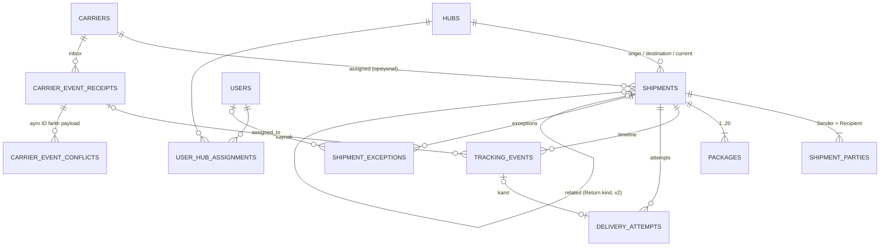

# 04 — Veritabanı Tasarımı

> Hedef: PostgreSQL 18, EF Core 10 + Npgsql 10.0.x. İlgili: [02 Domain](02-domain-and-state-machines.md) · [03 ADR-03/04/05](03-architecture-decisions.md)

## 1. Genel kurallar

| Konu | Karar |
|---|---|
| Şemalar | `shipments`, `tracking`, `operations`, `identity`, `platform` |
| Adlandırma | `snake_case` tablo/kolon; tablolar çoğul |
| Birincil anahtar | Aggregate'ler `uuid` (UUIDv7, uygulamada üretilir). Yüksek hacimli append-only tablolar (`tracking_events`, `outbox_messages`, `audit_entries`) `bigint GENERATED ALWAYS AS IDENTITY` — sıralama ve cursor için. |
| Zaman | Daima `timestamptz` (UTC saklanır). İş tarihi (`promised_delivery_date`) `date`, Europe/Istanbul takvimine göre. `timestamp without time zone` kullanılmaz. |
| Enum | `varchar(32)` + `CHECK (col IN (...))`. EF Core `HasConversion<string>()`. |
| Para | `numeric(12,2)` + `char(3)` ISO 4217; ikisi birlikte null veya birlikte dolu. `float`/`money` tipi yok. |
| Ölçü | Gram / milimetre `int`. |
| Concurrency | `xmin` (sistem kolonu) EF Core concurrency token: `shipments`, `shipment_exceptions`. |
| Silme | Fiziksel silme yok (gönderi, olay, istisna). Kişisel veri silme yerine maskeleme (§6). |
| PII yeri | Yalnız `shipments.shipment_parties` ve (geçici) ham payload kolonları. |

## 2. ER taslağı



Platform tabloları (`idempotency_records`, `outbox_messages`, `audit_entries`) iş tablolarına FK ile bağlanmaz; `entity_type` + `entity_id` metinleriyle referans verir (audit kaydı, referans verdiği satırdan bağımsız yaşamalı).

## 3. Tablolar

### 3.1 `operations.hubs`

| Kolon | Tip | Kısıt |
|---|---|---|
| `id` | uuid | PK |
| `code` | varchar(10) | NOT NULL, UNIQUE, `CHECK (code ~ '^[A-Z]{3}-[0-9]{2}$')` (ör. `IST-01`) |
| `name` | varchar(100) | NOT NULL |
| `city` | varchar(100) | NOT NULL — public timeline'da gösterilen konum |
| `district` | varchar(100) | NULL |
| `is_active` | boolean | NOT NULL DEFAULT true |
| `created_at` | timestamptz | NOT NULL |

### 3.2 `shipments.shipments`

| Kolon | Tip | Kısıt / not |
|---|---|---|
| `id` | uuid | PK |
| `tracking_number` | varchar(12) | NOT NULL, UNIQUE, `CHECK (tracking_number ~ '^LS[0-9]{10}$')` |
| `public_tracking_code` | varchar(26) | NOT NULL, UNIQUE |
| `kind` | varchar(16) | NOT NULL DEFAULT `'Forward'`, `CHECK IN ('Forward','Return')` |
| `related_shipment_id` | uuid | NULL, FK → `shipments.id` (v2 iade) |
| `external_reference` | varchar(64) | NULL, **unique değil** |
| `service_level` | varchar(16) | NOT NULL, `CHECK IN ('Standard','Express')` |
| `status` | varchar(32) | NOT NULL, `CHECK IN ('Created','AtHub','InTransit','OutForDelivery','DeliveryFailed','Delivered','ReturningToSender','ReturnedToSender','Cancelled')` |
| `status_occurred_at` | timestamptz | NOT NULL |
| `status_changed_at` | timestamptz | NOT NULL |
| `origin_hub_id` | uuid | NOT NULL, FK → `operations.hubs` |
| `destination_hub_id` | uuid | NOT NULL, FK → `operations.hubs` |
| `current_hub_id` | uuid | NULL, FK → `operations.hubs` |
| `carrier_id` | uuid | NULL, FK → `tracking.carriers` |
| `carrier_handed_over_at` | timestamptz | NULL |
| `has_departed` | boolean | NOT NULL DEFAULT false |
| `package_count` | smallint | NOT NULL, `CHECK BETWEEN 1 AND 20` |
| `promised_delivery_date` | date | NOT NULL |
| `delivered_at` | timestamptz | NULL |
| `delivery_attempt_count` | smallint | NOT NULL DEFAULT 0, `CHECK >= 0` |
| `extra_attempts_granted` | smallint | NOT NULL DEFAULT 0 |
| `last_carrier_sequence` | bigint | NULL |
| `declared_value_amount` | numeric(12,2) | NULL, `CHECK >= 0` |
| `declared_value_currency` | char(3) | NULL |
| `cancellation_reason` | varchar(500) | NULL |
| `change_seq` | bigint | NOT NULL — `shipments.shipment_change_seq` dizisinden; `BEFORE INSERT OR UPDATE` trigger'ı ile atanır |
| `created_at` | timestamptz | NOT NULL |
| `created_by_user_id` | uuid | NOT NULL |
| `updated_at` | timestamptz | NOT NULL |
| `pii_redacted_at` | timestamptz | NULL |

Tablo düzeyi check constraint'ler:

```sql
CHECK ((status = 'Delivered') = (delivered_at IS NOT NULL)),
CHECK (status <> 'AtHub' OR current_hub_id IS NOT NULL),
CHECK (status <> 'Cancelled' OR cancellation_reason IS NOT NULL),
CHECK ((declared_value_amount IS NULL) = (declared_value_currency IS NULL)),
CHECK (kind = 'Forward' OR related_shipment_id IS NOT NULL)
```

İndeksler:

| İndeks | Amaç |
|---|---|
| `(created_at DESC, id DESC)` | Varsayılan liste sıralaması, keyset |
| `(status, promised_delivery_date)` | Durum + gecikme filtreleri |
| `(promised_delivery_date) WHERE status NOT IN ('Delivered','ReturnedToSender','Cancelled')` | Gecikme taraması (SLA worker, KPI) |
| `(current_hub_id, status)` | Hub kuyruğu, hub kapsamlı liste |
| `(destination_hub_id, status)` | Dağıtım hub'ı görünümü |
| `(origin_hub_id, created_at DESC)` | Çıkış hub'ı görünümü |
| `(carrier_id, status) WHERE carrier_id IS NOT NULL` | Carrier filtresi |
| `(external_reference) WHERE external_reference IS NOT NULL` | Harici referans araması |
| `(change_seq)` | Değişiklik akışı (SignalR reconnect telafisi) |
| `(delivered_at) WHERE delivered_at IS NOT NULL` | KPI pencereleri |

> **`change_seq` uyarısı:** Dizi değeri yazma anında alınır, commit sırası farklı olabilir. Okuyucu 105'i görüp henüz commit olmamış 104'ü kaçırabilir. Telafi: istemci cursor'ı `son görülen − 200` örtüşmesiyle ister ve `(id, change_seq)` ile tekrarları birleştirir; API ayrıca son 5 sn'de değişen satırları her yanıtta tekrar verir. Kesin sıralı akış gerekirse v2'de `pg_snapshot_xmin` tabanlı "güvenli üst sınır" yaklaşımı değerlendirilir.
>
> **Karar değişikliği (Dilim 1), sınır:** 200'lük örtüşme ve 5 sn geriye bakış **kesin reconnect telafisi garantisi değildir**; 5 sn'den uzun süren bir transaction'ın düşük `change_seq` ile commit'i kaçırılabilir. Dilim 10'dan önce şu ikisinden biri tasarlanacak: (a) yetkili snapshot resync (istemci kapsamındaki listeyi/detayı yeniden okur, cursor yalnız ipucu), (b) commit sırasına bağlı dayanıklı cursor (ör. `pg_current_snapshot()` xmin'inin altında kalan güvenli üst sınır). Bu dilimde change-feed/SignalR uygulanmadı.

### 3.3 `shipments.shipment_parties` (PII)

| Kolon | Tip | Kısıt |
|---|---|---|
| `shipment_id` | uuid | PK(1), FK → `shipments` ON DELETE RESTRICT |
| `role` | varchar(16) | PK(2), `CHECK IN ('Sender','Recipient')` |
| `full_name` | varchar(150) | NOT NULL (maskelemeden sonra `'[redacted]'`) |
| `company_name` | varchar(150) | NULL |
| `phone_e164` | varchar(16) | NULL (maskelemeden sonra NULL), `CHECK (phone_e164 ~ '^\+[1-9][0-9]{7,14}$')` |
| `phone_last4` | char(4) | NULL — aramada kullanılır |
| `email` | varchar(254) | NULL |
| `address_line1` | varchar(200) | NULL (maskelemeden sonra NULL) |
| `address_line2` | varchar(200) | NULL |
| `district` | varchar(100) | NULL |
| `city` | varchar(100) | NOT NULL — maskelemeden sonra da kalır (istatistik) |
| `postal_code` | varchar(10) | NULL |
| `country_code` | char(2) | NOT NULL DEFAULT `'TR'` |

İndeks: `(role, phone_last4)` — "alıcı telefonunun son 4 hanesi" araması (tek başına değil, başka filtreyle birlikte kullanılır).
Snapshot kuralı: Satır gönderi oluşturulurken yazılır, v1'de güncellenmez. Adres düzeltme (v2) yeni değeri yazar ve audit'e yalnız "Recipient address changed" (değer yok) kaydeder.

### 3.4 `shipments.packages`

| Kolon | Tip | Kısıt |
|---|---|---|
| `id` | uuid | PK |
| `shipment_id` | uuid | NOT NULL, FK |
| `sequence` | smallint | NOT NULL, `CHECK BETWEEN 1 AND 20` |
| `label_code` | varchar(15) | NOT NULL, UNIQUE (`LS4829105735-01`) |
| `weight_grams` | int | NOT NULL, `CHECK BETWEEN 1 AND 70000` |
| `length_mm`, `width_mm`, `height_mm` | int | NOT NULL, `CHECK BETWEEN 1 AND 3000` |
| `content_description` | varchar(200) | NULL |
| `current_hub_id` | uuid | NULL, FK → hubs |
| `last_scan_type` | varchar(32) | NULL, `CHECK IN ('Arrival','Departure','OutForDelivery')` |
| `last_scanned_at` | timestamptz | NULL |

UNIQUE `(shipment_id, sequence)`.

### 3.5 `shipments.tracking_events` (append-only)

| Kolon | Tip | Kısıt / not |
|---|---|---|
| `id` | bigint identity | PK — global sıra, timeline cursor'ı |
| `shipment_id` | uuid | NOT NULL, FK |
| `event_type` | varchar(32) | NOT NULL, `CHECK IN ('Created','ArrivedAtHub','DepartedHub','HandedToCarrier','CarrierInTransit','OutForDelivery','DeliveryFailed','Delivered','ReturnInitiated','ReturnedToSender','Cancelled')` |
| `source` | varchar(16) | NOT NULL, `CHECK IN ('HubScan','Operator','Carrier','System')` |
| `outcome` | varchar(16) | NOT NULL, `CHECK IN ('Applied','Stale','PendingReview')` |
| `is_late` | boolean | NOT NULL DEFAULT false — `received_at` güncel durumdan sonra ama `occurred_at` önce |
| `occurred_at` | timestamptz | NOT NULL |
| `occurred_at_offset_minutes` | smallint | NOT NULL |
| `received_at` | timestamptz | NOT NULL |
| `status_before` | varchar(32) | NULL yalnız `event_type = 'Created'` için (`CHECK ((event_type = 'Created') = (status_before IS NULL))`); **Karar değişikliği (Dilim 1):** oluşturma olayının önceki durumu yoktur |
| `status_after` | varchar(32) | NULL — yalnız `Applied` ve durum değiştiyse |
| `hub_id` | uuid | NULL, FK |
| `location_code` | varchar(20) | NULL — hub kodu veya carrier facility kodu |
| `location_city` | varchar(100) | NULL — public gösterim için tek konum alanı |
| `package_id` | uuid | NULL, FK |
| `delivery_attempt_number` | smallint | NULL |
| `reason_code` | varchar(64) | NULL (ör. `RecipientAbsent`, `MissingDepartureScan`, `contradicts-terminal`) |
| `actor_user_id` | uuid | NULL |
| `carrier_event_receipt_id` | uuid | NULL, FK → `tracking.carrier_event_receipts` |
| `carrier_sequence` | bigint | NULL |
| `client_scan_id` | varchar(64) | NULL — el terminalinin tarama kimliği |
| `business_key` | varchar(160) | NOT NULL |
| `internal_note` | varchar(500) | NULL — public ve audit'e çıkmaz |

İndeksler: `(shipment_id, occurred_at, id)` (timeline), `(shipment_id, business_key, occurred_at)` (iş tekrarı), UNIQUE `(hub_id, client_scan_id) WHERE client_scan_id IS NOT NULL`, UNIQUE `(carrier_event_receipt_id) WHERE carrier_event_receipt_id IS NOT NULL`.

### 3.6 `shipments.delivery_attempts`

| Kolon | Tip | Kısıt |
|---|---|---|
| `id` | uuid | PK |
| `shipment_id` | uuid | NOT NULL, FK |
| `attempt_number` | smallint | NOT NULL, `CHECK >= 1` |
| `occurred_at` | timestamptz | NOT NULL |
| `outcome` | varchar(16) | NOT NULL, `CHECK IN ('Delivered','Failed')` |
| `failure_reason` | varchar(32) | NULL, `CHECK IN ('RecipientAbsent','AddressNotFound','RecipientRefused','AccessRestricted','PackageMissing','PackageDamaged','Other')` |
| `source` | varchar(16) | NOT NULL |
| `tracking_event_id` | bigint | NOT NULL, FK, UNIQUE |
| `recorded_by_user_id` | uuid | NULL |
| `note` | varchar(500) | NULL |

UNIQUE `(shipment_id, attempt_number)`; `CHECK ((outcome = 'Failed') = (failure_reason IS NOT NULL))`; `CHECK (failure_reason <> 'Other' OR note IS NOT NULL)`.

### 3.7 `operations.shipment_exceptions`

| Kolon | Tip | Kısıt |
|---|---|---|
| `id` | uuid | PK |
| `shipment_id` | uuid | NOT NULL, FK |
| `type` | varchar(32) | NOT NULL, `CHECK IN ('DeliveryFailed','MaxAttemptsReached','DeliveryOverdue','NoMovement','PackageSplit','CarrierEventPendingReview','CarrierEventConflict')` |
| `severity` | varchar(8) | NOT NULL, `CHECK IN ('Low','Medium','High')` |
| `status` | varchar(16) | NOT NULL, `CHECK IN ('Open','Assigned','Resolved')` |
| `hub_id` | uuid | NULL — açılış anındaki `current_hub_id` (kuyruk filtresi) |
| `occurrence_count` | int | NOT NULL DEFAULT 1 |
| `opened_at` | timestamptz | NOT NULL |
| `last_occurred_at` | timestamptz | NOT NULL |
| `opened_by_source` | varchar(16) | NOT NULL |
| `due_at` | timestamptz | NOT NULL — High: +4 iş saati, Medium: +1 iş günü |
| `assigned_to_user_id` | uuid | NULL, FK → identity users |
| `assigned_at` | timestamptz | NULL |
| `resolved_at` | timestamptz | NULL |
| `resolved_by_user_id` | uuid | NULL |
| `resolution_code` | varchar(32) | NULL |
| `resolution_note` | varchar(1000) | NULL |
| `related_tracking_event_id` | bigint | NULL |
| `related_receipt_id` | uuid | NULL |

```sql
CHECK (status <> 'Assigned' OR assigned_to_user_id IS NOT NULL),
CHECK ((status = 'Resolved') = (resolved_at IS NOT NULL AND resolution_code IS NOT NULL))
```

İndeksler: UNIQUE `(shipment_id, type) WHERE status IN ('Open','Assigned')` (tek açık kayıt kuralı), `(status, severity, due_at) WHERE status <> 'Resolved'` (kuyruk), `(assigned_to_user_id, status) WHERE status = 'Assigned'`, `(hub_id, status)`.

### 3.8 `tracking.carriers`

`id uuid PK`, `code varchar(16) UNIQUE` (`SIMEX`), `name varchar(100)`, `is_active boolean`, `sends_sequence boolean`. **Webhook secret'ları bu tabloda değil**, secret store'da (bkz. [06 §5](06-security-and-failure-behavior.md#5-secret-yönetimi-ve-loglama)).

### 3.9 `tracking.carrier_event_receipts` (inbox)

| Kolon | Tip | Kısıt / not |
|---|---|---|
| `id` | uuid | PK |
| `carrier_id` | uuid | NOT NULL, FK |
| `external_event_id` | varchar(100) | NOT NULL |
| `payload_sha256` | bytea | NOT NULL, `CHECK (octet_length(payload_sha256) = 32)` — kanonik JSON hash'i |
| `payload` | jsonb | NULL — normalize edilmiş JSON, 30 gün sonra NULL |
| `raw_body` | bytea | NULL — **Karar değişikliği (Dilim 1):** imzalı orijinal byte'lar (jsonb boşluk/sıra/yinelenen alanı korumaz, imza kanıtı olamaz); 30 gün sonra NULL. Ham byte kanıtı yalnız `payload_sha256` + `raw_body`'dir |
| `payload_purged_at` | timestamptz | NULL |
| `signature_timestamp` | timestamptz | NOT NULL |
| `received_at` | timestamptz | NOT NULL |
| `tracking_number` | varchar(12) | NULL — parse edilen alan |
| `shipment_id` | uuid | NULL — çözülürse |
| `event_type` | varchar(32) | NULL — normalize `TrackingEventType` |
| `occurred_at` | timestamptz | NULL |
| `carrier_sequence` | bigint | NULL |
| `processing_status` | varchar(16) | NOT NULL, `CHECK IN ('Received','Processing','Processed','DeadLettered')` |
| `outcome` | varchar(16) | NULL, `CHECK IN ('Applied','Duplicate','Stale','Rejected','PendingReview')` |
| `outcome_reason` | varchar(64) | NULL |
| `attempts` | smallint | NOT NULL DEFAULT 0 |
| `next_attempt_at` | timestamptz | NOT NULL |
| `locked_until` | timestamptz | NULL |
| `locked_by` | varchar(64) | NULL |
| `processed_at` | timestamptz | NULL |
| `last_error` | varchar(2000) | NULL — exception tipi + mesaj, PII yok |

UNIQUE `(carrier_id, external_event_id)` — teknik tekrar ve `Conflict` tespitinin temeli.
`CHECK ((processing_status = 'Processed') = (outcome IS NOT NULL))`.
İndeksler: `(next_attempt_at) WHERE processing_status IN ('Received','Processing')` (lease taraması), `(shipment_id, received_at)`.

> **Karar değişikliği (Dilim 6):** Eklenen kolonlar `raw_sha256 bytea NOT NULL` (imzalı ham byte hash'i) ve `lock_token uuid NULL` (fencing; her claim'de yenilenir,
> işleme ve sonuç yazımı `id + lock_token` koşuludur — [ADR-016](adr/ADR-016-carrier-inbox-lease-and-fencing.md)). Ek CHECK'ler:
> `processing_status <> 'Processing' OR (lock_token IS NOT NULL AND locked_until IS NOT NULL)`, `raw_body IS NOT NULL OR payload_purged_at IS NOT NULL`,
> `carrier_sequence >= 0`. `last_error` yalnız exception **tipi** tutar (mesaj PII/bağlantı ayrıntısı içerebilir). Ek indeks `(tracking_number, received_at)`
> (henüz gönderiye bağlanmamış makbuzların operatör görünümü). `payload` kanonik allowlist alanlarıdır; bilinmeyen alanlar saklanmaz.
> `shipments.shipments`'a `carrier_id` (FK → `tracking.carriers`), `carrier_handed_over_at`, `last_carrier_sequence` eklendi. Runtime rol: `carriers` SELECT,
> makbuz/çakışma SELECT/INSERT/UPDATE (DELETE yok).

### 3.10 `tracking.carrier_event_conflicts`

`id uuid PK`, `receipt_id uuid FK NOT NULL`, `received_at timestamptz`, `payload_sha256 bytea`, `payload jsonb NULL` (30 gün), `payload_purged_at`, `signature_timestamp`. İndeks `(receipt_id)`.

> **Karar değişikliği (Dilim 6):** Çakışma kanıtı `payload jsonb` yerine imzalı **ham** gövdeyi tutar: `raw_body bytea NULL` + `raw_sha256 bytea NOT NULL`
> (+ `payload_sha256`); `CHECK (raw_body IS NOT NULL OR payload_purged_at IS NOT NULL)`.

### 3.11 `identity.*`

ASP.NET Core Identity'nin standart tabloları (`users`, `roles`, `user_roles`, `user_claims`, `user_logins`, `user_tokens`, `role_claims`) `identity` şemasında, `uuid` anahtarla.
Ek: `identity.user_hub_assignments (user_id uuid FK, hub_id uuid FK, assigned_at timestamptz, assigned_by_user_id uuid, PRIMARY KEY (user_id, hub_id))`, indeks `(hub_id)`.

### 3.12 `platform.idempotency_records`

| Kolon | Tip | Kısıt |
|---|---|---|
| `id` | uuid | PK |
| `actor_scope` | varchar(100) | NOT NULL — `user:{userId}` veya `client:{clientId}` |
| `endpoint` | varchar(100) | NOT NULL — `POST /api/shipments` (route şablonu, gerçek path değil) |
| `idempotency_key` | varchar(128) | NOT NULL, `CHECK (idempotency_key ~ '^[A-Za-z0-9_-]{16,128}$')` |
| `request_hash` | bytea | NOT NULL, `CHECK (octet_length(request_hash) = 32)` |
| `request_hash_version` | smallint | NOT NULL, `>= 1` — kanonik gösterim sürümü ([05 §3](05-api-and-event-contracts.md#3-idempotency-contractı)) |
| `response_status_code` | smallint | NULL (claim süresince); tamamlanınca 200–299 |
| `response_content_type` | varchar(100) | NULL (claim süresince) |
| `response_body` | bytea | NULL (claim süresince) — ilk yanıtın birebir UTF-8 byte'ları; **PII içermez** (oluşturma yanıtı bilerek dar tutulur, [05 §4.1](05-api-and-event-contracts.md#41-post-apishipments)) |
| `response_location` | varchar(200) | NULL |
| `response_etag` | varchar(64) | NULL |
| `resource_id` | uuid | NULL |
| `created_at` | timestamptz | NOT NULL — enjekte `TimeProvider` UTC |
| `completed_at` | timestamptz | NULL (claim süresince) |
| `expires_at` | timestamptz | NOT NULL — `created_at + 48 saat`, `CHECK (expires_at > created_at)` |

UNIQUE `ux_idempotency_records_scope_key (actor_scope, endpoint, idempotency_key)`; indeks `(expires_at)`.

> **Karar değişikliği (Dilim 1):** Taslaktaki `jsonb` yanıt gövdesi ve `response_headers` kaldırıldı: jsonb alan sırasını ve biçimini korumaz, replay byte-byte aynı olmalı. Yanıt kolonları claim süresince NULL'dır; `ck_idempotency_records_completion` ya hepsinin NULL ya da hepsinin dolu (2xx) olmasını zorlar. `trg_idempotency_records_completed_at_commit` (DEFERRABLE INITIALLY DEFERRED constraint trigger) tamamlanmamış bir kaydın COMMIT edilmesini `23514` ile reddeder; böylece yarım claim dışarıdan "başarı" gibi görülemez. Periyodik temizlik dilim 8'de; o zamana kadar süresi dolmuş kayıt yeniden claim sırasında satır kilidi altında silinir.

### 3.13 `platform.outbox_messages`

`id bigint identity PK`, `message_id uuid UNIQUE`, `type varchar(100)`, `payload jsonb` (PII yok: id'ler, durumlar), `occurred_at`, `available_at`, `attempts smallint`, `locked_until`, `locked_by varchar(64)`, `processed_at`, `dead_lettered_at`, `last_error varchar(2000)`.
İndeks: `(available_at, id) WHERE processed_at IS NULL AND dead_lettered_at IS NULL`.

> **Karar değişikliği (Dilim 7):** Ek kolonlar `lock_token uuid NULL` (fencing) ve `replay_count smallint`; CHECK'ler: tip biçimi `^[a-z][a-z0-9.-]{2,99}$`,
> payload en fazla 8 KB, `processed_at` ve `dead_lettered_at` aynı anda dolu olamaz. `last_error` yalnız hata tipi (veya `no-handler`). Ek tablo
> `platform.notification_deliveries (message_id uuid PK, shipment_id, template, recorded_at)` — simüle bildirim kanalının tekrar ayıklama kaydı, PII yok.
> Runtime rol: outbox SELECT/INSERT/UPDATE/DELETE (retention silmesi), bildirim kaydı SELECT/INSERT.

### 3.14 `platform.audit_entries` (append-only)

| Kolon | Tip | Not |
|---|---|---|
| `id` | bigint identity | PK |
| `occurred_at` | timestamptz | |
| `actor_type` | varchar(16) | `User`, `Carrier`, `System`, `Anonymous` |
| `actor_id` | varchar(100) | Kullanıcı id, carrier kodu, worker adı |
| `action` | varchar(64) | `ShipmentCreated`, `HubScanRecorded`, `ShipmentCancelled`, `ExceptionResolved`, `CarrierEventConflictDetected`, `LoginFailed` … |
| `entity_type` / `entity_id` | varchar(64) | |
| `outcome` | varchar(16) | `Succeeded`, `Rejected` |
| `reason_code` | varchar(64) | NULL |
| `correlation_id` | varchar(64) | trace id |
| `changes` | jsonb | **Allowlist** alanlar: durum, hub id, atanan kullanıcı id, çözüm kodu. PII alanı değişirse yalnız alan adı (`{"recipient.address": "changed"}`). |

İndeksler: `(entity_type, entity_id, occurred_at)`, `(actor_id, occurred_at)`.
**Append-only zorlama:** Uygulama DB rolü (`lst_app`) bu tabloda yalnız `INSERT, SELECT` yetkisine sahiptir; silme yalnız retention işi için ayrı `lst_maintenance` rolüyle.

> **Uygulama (Dilim 1):** Migration'ları tablo sahibi rol uygular; çalışma zamanı rolünün yetkileri [`db/runtime-role-grants.sql`](../db/runtime-role-grants.sql) dosyasındadır (audit için yalnız `SELECT, INSERT`). Integration testleri ayrı bir çalışma zamanı rolüyle bağlanır ve bu rolün `UPDATE/DELETE/TRUNCATE` denemesinin `42501` ile reddedildiğini doğrular.

## 4. Diziler ve trigger'lar

- `shipments.shipment_change_seq` + `BEFORE INSERT OR UPDATE ON shipments.shipments` trigger'ı `NEW.change_seq := nextval(...)`. EF Core bu kolonu `ValueGeneratedOnAddOrUpdate` olarak okur.
- Başka trigger yok; iş kuralı trigger'a taşınmaz.

## 5. Transaction izolasyonu

- Varsayılan `READ COMMITTED` + optimistic concurrency (`xmin`). `SERIALIZABLE` kullanılmaz (retry yükü, gerek yok).
- Idempotency claim için transaction başında `SET LOCAL lock_timeout = '5s'`.
- Lease sorguları `FOR UPDATE SKIP LOCKED` ile kısa transaction'larda.

## 6. Kişisel veri ve retention

| Veri | Saklama | Sonra | Erişim |
|---|---|---|---|
| Gönderen/alıcı adı, telefon, e-posta, adres satırları | Terminal durumdan **180 gün** (varsayım A2) | Maskeleme: ad `[redacted]`, telefon/e-posta/adres satırları NULL; şehir/ilçe/posta kodu kalır; `pii_redacted_at` dolar | Rol + hub kapsamı ([06 §2](06-security-and-failure-behavior.md#2-yetkilendirme)) |
| Terminal olmayan ama 365 günden eski gönderi | — | Yöneticiye rapor; otomatik maskeleme yok | |
| Ham webhook payload (`payload`) | **30 gün** (varsayım A3) | NULL, `payload_purged_at` dolar; hash ve normalize alanlar kalır | Yalnız DB `lst_maintenance` rolü; API/UI'da yok |
| Carrier receipt satırları | 13 ay | Silinir | |
| `tracking_events` | Gönderiyle aynı (silinmez) | `internal_note` gönderi maskelenirken NULL | |
| Idempotency kayıtları | 48 saat | Silinir — sonrasında aynı anahtar yeni istek sayılır | |
| Outbox (işlenmiş) | 7 gün | Silinir; dead-letter'lar elle temizlenene kadar kalır | |
| Audit | 2 yıl (varsayım) | `lst_maintenance` ile silinir | OpsManager |
| Uygulama logları | 30 gün | Log altyapısında | PII içermez |

> **Karar değişikliği (Dilim 8):** Carrier receipt satırları **silinmez** (tombstone): `tracking_events.carrier_event_receipt_id` FK'si ve teknik
> tekrar ayıklaması korunur; 30 gün sonra yalnız `raw_body` + `payload` NULL olur (`payload_purged_at`), hash'ler ve normalize kolonlar kalır;
> çakışma kanıtının ham gövdesi de aynı kurala tabidir. PII maskelemesinde iptal nedeni `[redacted]` olur (iptal CHECK'i nedeni zorunlu kılar),
> olay/deneme/istisna notları NULL; `shipment_parties.phone_e164`, `phone_last4`, `address_line1` nullable yapıldı
> (`CHECK ((phone_e164 IS NULL) = (phone_last4 IS NULL))`), `shipments.pii_redacted_at` ve aday indeksi eklendi. Idempotency kayıtları süreleri
> (48 saat) dolunca silinir; işlenmiş outbox 7 gün. İş runtime rolüyle çalışır (audit silmez) — [ADR-018](adr/ADR-018-public-tracking-rate-limit-retention.md).

**Ham payload neden saklanıyor?** Carrier ile anlaşmazlıkta (ör. `Conflict`, `PendingReview`) orijinal bayt içeriği tek kanıttır ve normalize etme hatalarının ayıklanmasını sağlar. Payload alıcı adı/adres içerebileceği için süre kısa, erişim yalnız bakım rolüne açık, log ve audit'e kopyalanmaz.

## 7. Migration politikası

- EF Core migration'ları kod incelemesinde SQL script olarak da gözden geçirilir.
- Üretimde uygulama açılışında otomatik migration **yapılmaz**; ayrı adım (`dotnet ef database update` veya idempotent script) çalıştırılır. Development'ta `Database:MigrateOnStartup=true` serbest.
- `/health/ready` bekleyen migration varsa `Unhealthy` döner.
- Check constraint ve partial index'ler migration'da açıkça tanımlanır (EF Core `HasCheckConstraint`, `HasFilter`).
