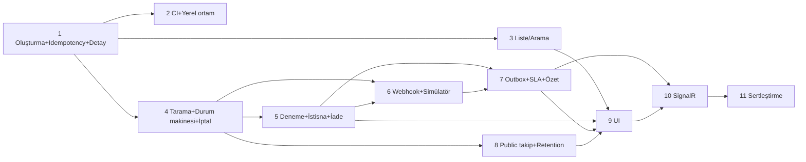

# 08 — Uygulama Planı

> İlgili: [03 Mimari](03-architecture-decisions.md) · [05 Endpoint listesi](05-api-and-event-contracts.md#2-endpoint-listesi-v1) · [09 Test planı](09-test-and-verification-plan.md)

## 1. Planlama ilkeleri

- Her dilim **gerçek bir iş davranışını** uçtan uca (HTTP → domain → DB) gösterir ve kendi testleriyle kapanır.
- Bir dilim bir öncekinin üzerine kurulur; bağımlılıklar açıktır. Bir dilimde yalnız o dilimin ihtiyaç duyduğu tablolar ve modüller eklenir.
- "Önce tüm entity'ler, sonra tüm endpoint'ler" yapılmaz.
- Her dilimin sonunda: `dotnet build` uyarısız, testler yeşil, ilgili doküman bölümü güncel, kısa CHANGELOG notu.
- Bir dilim tek bir AI/uygulama görevine sığacak büyüklüktedir; daha büyükse bölünür.

## 2. Dilimler

| # | Dilim | İş davranışı | Bağımlılık | Ana çıktılar |
|---|---|---|---|---|
| 0 | Tasarım | — | — | Bu doküman seti, statik prototip (**tamamlandı**) |
| 1 | Gönderi oluşturma + idempotency + yetkili detay | Operatör gönderi açar; yanıt kaybolsa da tekrar güvenli; yetkili kullanıcı detayı görür, kapsam dışı göremez | — | Solution iskeleti, `Lst.Api`, `Lst.Platform`, `Lst.Modules.Shipments`, `Lst.Modules.Identity`; hub seed; E1–E3; idempotency + audit tabloları |
| 2 | CI + yerel çalışma ortamı | Her push'ta derleme ve testler; yeni geliştirici tek komutla DB'yi ayağa kaldırır | 1 | GitHub Actions workflow, `docker-compose.yml` (yalnız PostgreSQL), README "nasıl çalıştırılır" |
| 3 | Gönderi listesi ve arama | Görevli filtreleyip arar; hub görevlisi yalnız kendi kapsamını görür | 1 | E4, keyset cursor (imzalı), indeksler |
| 4 | Hub taramaları + durum makinesi + iptal | Koli varış/çıkış/dağıtım; konsolidasyon; eşzamanlı tarama; iptal sınırı | 1 | `ShipmentStateMachine`, `Decide`, `tracking_events`, E5, E6, `If-Match`/ETag |
| 5 | Teslimat denemeleri + istisna kuyruğu + iade | Başarısız teslim istisna açar; görevli üzerine alır ve çözer; iade akışı | 4 | `delivery_attempts`, `Operations` modülü, `shipment_exceptions`, E7–E11 |
| 6 | Carrier webhook alımı + simülatör | İmzalı olaylar alınır; tekrar/sıra dışı/çelişkili olaylar doğru sınıflanır; çökme sonrası kurtarma | 4 (5 ile istisna açılışı) | `Tracking` modülü, inbox + conflict tabloları, `CarrierInboxProcessor` worker, E12, E13 |
| 7 | Outbox + SLA worker + özet + audit okuma | Gecikmiş gönderi istisnaya düşer; KPI'lar formülle; yönetici audit okur | 5, 6 | `outbox_messages`, `OutboxDispatcher`, `SlaMonitor`, E14, E18 |
| 8 | Public takip + rate limit + retention | Alıcı PII görmeden takip eder; eski PII maskelenir | 4 | E15, E16, rate limiter, `RetentionJob` |
| 9 | Operasyon UI (React) | Liste, detay, istisna kuyruğu, public takip ekranları gerçek API'ye bağlı | 3, 5, 7, 8 | `src/web`, Playwright E2E (3 akış) |
| 10 | Canlı güncelleme (SignalR) | Panel değişikliği yenilemeden görür; kopma sonrası boşluk kapanır | 7, 9 | E17, `OperationsRealtimeHub`, outbox → SignalR yayıncısı |
| 11 | Sertleştirme ve runbook | Üretime hazırlık kontrol listesi | hepsi | Tam docker-compose (API + DB), runbook (dead-letter, migration, secret rotasyonu), benchmark senaryoları (çalıştırma ayrı karar) |

## 3. Dilim ayrıntıları ve kabul ölçütleri

### Dilim 1 — Gönderi oluşturma + kalıcı idempotency + yetkili detay

**Neden ilk dilim bu?** Sistemin ilk kalıcı varlığı gönderidir; diğer her şey (tarama, olay, istisna, public takip) var olan bir gönderiye dayanır. Idempotency ve yetki ilk günden doğru kurulmazsa sonradan eklemek tüm endpoint'lere dokunmayı gerektirir. Durum makinesi bu dilimde yalnız `Created` başlangıç durumunu kullanır; geçişler dilim 4'tedir. Alternatif olarak "durum makinesi + taramalar" ilk dilim olabilirdi; ama onu test etmek için zaten gönderi oluşturmak gerekir ve idempotency/yetki altyapısı yine ilk sırada kalırdı.

Kabul: [next-task-prompt.txt](next-task-prompt.txt)'teki ölçütler.

### Dilim 2 — CI + yerel ortam

- GitHub Actions: `ubuntu-latest`, `actions/setup-dotnet` (10.0.x), `dotnet restore --locked-mode`, `dotnet build -warnaserror`, `dotnet format --verify-no-changes`, unit testler, integration testler (Testcontainers; GitHub runner'da Docker var).
- Workflow izinleri `contents: read`; üçüncü taraf action'lar commit SHA ile sabitlenir; secret kullanılmaz.
- Artifact: yalnız `*.trx` test sonuçları ve kapsama raporu (Cobertura), 7 gün saklama. DB dump'ı, log'lar, `appsettings.*.json` yüklenmez.
- `dotnet list package --vulnerable --include-transitive` adımı; yüksek önem bulgusu build'i kırar.
- `docker-compose.yml`: `postgres:18` + named volume + healthcheck; parola `.env` dosyasından (`.env.example` repoda, `.env` `.gitignore`'da).
- Kabul: PR'da workflow yeşil; kasıtlı bozuk test workflow'u kırmızıya çevirir; `docker compose up -d` sonrası `dotnet run` ile `/health/ready` `Healthy`.

### Dilim 3 — Liste ve arama

- Kabul: 1) her filtre tek başına ve birlikte doğru sonuç verir; 2) keyset sayfalama 3 sayfa boyunca tekrar/kayıp üretmez (aynı `created_at` değerine sahip satırlar dahil); 3) değiştirilmiş cursor `400`; 4) HubOperator yalnız kapsamını görür ve sayfa boyutu kapsam filtresinden sonra doğrudur; 5) `q=4567` başka filtre olmadan `400`.

### Dilim 4 — Taramalar + durum makinesi + iptal

- Kabul: 1) geçiş tablosundaki her satır için unit test, tablo dışı her (durum × tetikleyici) kombinasyonu reddedilir; 2) paketlerin hepsi hub'da değilken çıkış taraması `409 packages-not-consolidated` döner (`PackageSplit` istisnası dilim 5'te eklenir); 3) iki eşzamanlı varış taraması → biri `Applied`, diğeri yeniden değerlendirmede `Applied (PackageLocationOnly)` veya `Duplicate`; DB'de tek durum geçişi; 4) çıkış sonrası iptal `409` + `returnToSenderAllowed`; 5) `If-Match` yok → `428`, eski ETag → `412`; 6) aynı `clientScanId` → `Duplicate`.

### Dilim 5 — Denemeler + istisnalar + iade

- Kabul: 1) başarısız deneme `DeliveryFailed` istisnası açar, ikinci başarısızlık aynı kaydın `occurrence_count`'unu artırır; 2) 3. başarısızlıkta `MaxAttemptsReached`, sonraki dağıtıma çıkış `409`; 3) `ReattemptApproved` sonrası bir dağıtım hakkı; 4) `ReturnToSenderInitiated` çözümü gönderiyi `ReturningToSender` yapar; gönderi arada değiştiyse çözüm de geri alınır; 5) iki kişi aynı istisnayı üzerine almaya çalışır → biri `412`; 6) `PackageSplit` konsolidasyon reddinde açılır.

### Dilim 6 — Webhook + simülatör

- Kabul: [09 §3](09-test-and-verification-plan.md#3-test-matrisi) matrisindeki W1–W9 satırları. Özellikle: geçersiz imza `401` ve inbox'a yazılmaz; aynı ID/aynı payload `200 Duplicate`; aynı ID/farklı payload `409` + conflict kaydı + istisna; teslimattan sonra eski olay `Stale` ve timeline'da; worker işlem ortasında öldürülünce lease sonrası başka worker tamamlar ve tek durum geçişi olur.

### Dilim 7 — Outbox + SLA + özet + audit

- Kabul: 1) durum değişikliği ve outbox mesajı aynı transaction'da (rollback testinde ikisi de yok); 2) dispatcher handler sonrası, `processed_at` öncesi öldürülürse mesaj yeniden işlenir ve tüketici tekrarı ayıklar; 3) poison mesaj 8 denemede dead-letter; 4) `SlaMonitor` iki instance'ta aynı anda çalıştırılınca tek istisna; 5) KPI'lar sabit seed veride beklenen sayıları verir.

### Dilim 8 — Public takip + retention

- Kabul: 1) yanıt JSON alan kümesi contract testinde sabit (fazla alan testi kırar); 2) seed edilmiş PII değerlerinin (ad, telefon, adres satırı, posta kodu) hiçbiri yanıt gövdesinde geçmez; 3) geçersiz ve bulunamayan kod aynı `404` gövdesi; 4) 21. istek `429`; 5) kod yenileme sonrası eski kod `404`; 6) retention işi 180 günü geçmiş terminal gönderileri maskeler, diğerlerine dokunmaz, iki kez çalışınca değişiklik yapmaz.

### Dilim 9 — UI

- Kabul: Playwright ile 3 akış — (a) gönderi oluştur → detayda gör, (b) istisna üzerine al → çöz → kuyruktan düşer, (c) public takip mobil viewport'ta PII içermez. Axe ile otomatik erişilebilirlik taramasında kritik ihlal yok; klavye ile liste → detay → işlem akışı tamamlanır.

### Dilim 10 — SignalR

- Kabul: 1) yetkisiz hub grubuna abonelik reddedilir; 2) bağlantı koparılıp bu sırada 3 değişiklik yapılınca, yeniden bağlanan istemci `changes?after=` ile üçünü de alır; 3) SignalR yayını hata verse de komut commit olur; 4) bayat veri uyarısı kopuklukta görünür.

### Dilim 11 — Sertleştirme

- Runbook: dead-letter yeniden kuyruğa alma, migration uygulama, secret rotasyonu (iki secret dönemi), PII maskeleme işinin elle çalıştırılması.
- Benchmark senaryoları yazılır ([09 §8](09-test-and-verification-plan.md#8-gelecekteki-benchmark-planı)); çalıştırılması ve sonuçların yayımlanması ayrı karardır.

## 4. Riskler

| Risk | Etki | Azaltma |
|---|---|---|
| Ortamda .NET SDK/Docker yok | Dilim 1 başlayamaz | Ön koşul: .NET 10 SDK + PostgreSQL 18 (yerel veya Docker Desktop). Prompt bu durumda durup bildirir |
| `xmin` + EF Core 10 davranış farkı | Concurrency testleri kırılır | Dilim 4'te ilk iş entegrasyon testiyle doğrulamak; gerekirse açık `version` kolonu (`bigint`) + koşullu güncelleme |
| `EFCore.NamingConventions` EF 10 sürümü yok | snake_case kurulumu gecikir | Elle konvansiyon (birkaç satır) |
| Dilim kapsamının şişmesi | Test edilmemiş kod | Her dilimde "hariç" listesi; dilim sonunda kapsam kontrolü |
| UI'ın backend'i gölgelemesi | Portföy mesajı bulanıklaşır | UI dilim 9'da, bileşen kütüphanesi yok, README backend kararlarını önde anlatır |
